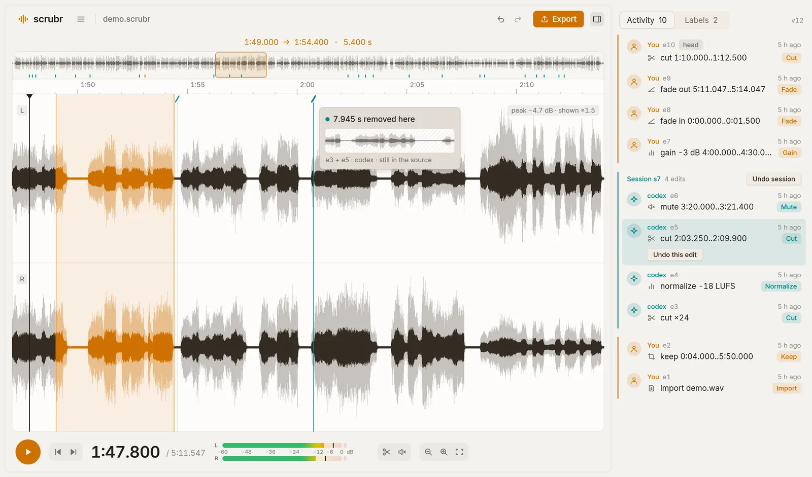
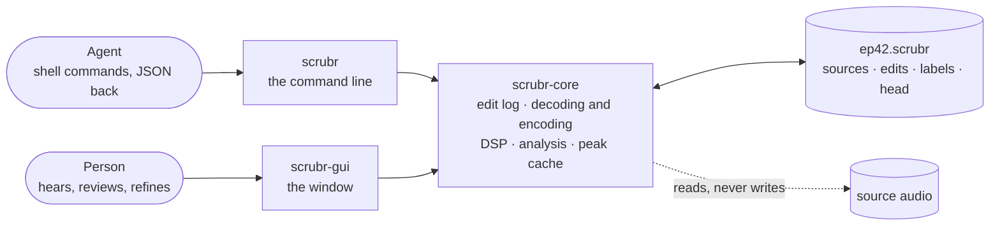

<p align="center">
  
</p>

<h1 align="center">scrubr</h1>

<p align="center">
  <b>An audio editor for agents and people.</b><br>
  Agents edit by running commands in a shell. People review and refine the same project in a native window.
</p>

<p align="center">
  
  
  
</p>

<p align="center">
  <picture>
    <source media="(prefers-color-scheme: dark)" srcset="docs/window-dark.webp">
    
  </picture>
</p>

<p align="center">
  <sub>Reviewing an agent's work. Your edits are amber and the agent's are blue-green. Audio an agent cut is still in the source, and one button undoes its whole session.</sub>
</p>

---

Coding agents such as Claude Code and Codex edit audio by running `scrubr` commands and reading JSON
back. A person opens the same project in a window, hears every edit, sees who made it, and keeps or
undoes each one.

Edits are **non-destructive**. Source files are never modified. A project is a list of edits over
the sources, and audio is rendered only on export. That shared list of edits is what lets an agent
and a person work on one project in the same sitting.

The name comes from scrubbing: dragging the playhead to hear the audio under it.

> [!NOTE]
> scrubr is early, at version 0.0.1. The command line, the window and multitrack are built and
> usable. Effects are planned. It is developed and tested on Windows so far; macOS and Linux are
> targets. See [Status](#status).

## Contents

- [A session](#a-session)
- [How it works](#how-it-works)
- [What an agent gets](#what-an-agent-gets)
- [What a person gets](#what-a-person-gets)
- [Build](#build)
- [Commands](#commands)
- [Transcription and cutting by words](#transcription-and-cutting-by-words)
- [Status](#status)
- [Documents](#documents)

## A session

Clean up a podcast: cut the long pauses, set the loudness, leave a note, export.

```sh
export SCRUBR_AUTHOR=codex SCRUBR_SESSION=s7

scrubr new ep42.scrubr --from raw/ep42.wav
scrubr analyze ep42.scrubr --loudness --silence -45dB:1s > report.json
# turn report.silence into cuts.json, keeping 0.15 s of each pause at both ends
scrubr apply ep42.scrubr --ops cuts.json --if-version 1
scrubr normalize ep42.scrubr --lufs -16
scrubr label ep42.scrubr add 14:18.5..14:20.2 "check: cough?"
scrubr render ep42.scrubr --png check.png
scrubr export ep42.scrubr out/ep42.flac
scrubr open ep42.scrubr          # hand it to a person
```

Every reply is JSON when stdout is not a terminal:

```json
{
  "ok": true,
  "project_version": 1,
  "timeline_seconds": 3449.0,
  "loudness": {"integrated_lufs": -21.4, "true_peak_dbtp": -7.2, "range_lu": 8.1},
  "silence": [{"start": 3.2, "end": 4.85}, {"start": 412.1, "end": 414.02}],
  "silence_count": 38
}
```

The agent passes `project_version` back as `--if-version`. If someone edited the project in
between, nothing is written and the reply says what to run next:

```json
{
  "ok": false,
  "error": {
    "code": "version_conflict",
    "message": "The project is at version 2, not 1: it changed since the version this command expected.",
    "hint": "Run `scrubr info ep42.scrubr` and `scrubr history ep42.scrubr` to see what changed, recompute positions, and retry with --if-version 2."
  }
}
```

## How it works



Two programs over one engine and one project file. Both write edits to the project, and the window
reloads when an agent changes it.

- **The timeline is computed, not stored.** A project file holds the sources, the edit log, labels
  and a head pointer. Undo moves head. No audio is rewritten until `export`.
- **Edits are stored against the source**, as a source id and a frame range, not as a time on the
  timeline. An edit keeps its meaning when an earlier one is undone, so one session's edits can be
  taken out of the middle of the log without moving anything made later.
- **Every edit has an author and a session.** `scrubr undo --of-session s7` reverts everything an
  agent did in one run, even when your own edits came after it.
- **Writes are locked and versioned.** A command takes a file lock, checks the version, writes a
  temporary file and renames it over the project. Two writers cannot both pass, and a killed
  command leaves the previous version intact.
- **Sources are checked.** Each is stored with its size, modified time and a BLAKE3 hash. If a
  source changes on disk, commands stop instead of editing against different audio.

<details>
<summary>A project file</summary>

```json
{
  "format": 1,
  "version": 7,
  "sample_rate": 48000,
  "channels": 2,
  "sources": [
    { "id": "src1", "path": "raw/ep42.wav", "frames": 172704000,
      "bytes": 1036224044, "mtime": "2026-11-10T09:14:02Z", "hash": "blake3:9f2c…" }
  ],
  "edits": [
    { "id": "e4", "op": "normalize", "lufs": -16.0, "gain_db": 5.4, "author": "codex", "session": "s7" },
    { "id": "e5", "op": "cut", "spans": [["src1", 37932000, 38251200]], "author": "codex", "session": "s7" }
  ],
  "head": "e5",
  "labels": [
    { "span": ["src1", 44935200, 45016800], "text": "check: cough?", "author": "codex" }
  ]
}
```

An example from the [PRD](docs/prd.html), with one track. A project that uses tracks has a higher
format number, and a build from before tracks refuses to read it.

</details>

## What an agent gets

An agent cannot listen, so scrubr gives it numbers, images and safe retries.

| | |
|---|---|
| **Measurements** | Loudness and true peak (EBU R128), sample peaks and clipping, silence ranges, a level envelope, and the quietest moment in a range: where to put a cut between two words. |
| **Images** | `render --png` draws the waveform of the timeline or a range, on the CPU, with no window. |
| **Transcripts** | Every word with a start and an end, from a Whisper model on your own machine. Optional; see [below](#transcription-and-cutting-by-words). |
| **Dry runs** | `--dry-run` on any edit reports what would change and writes nothing. |
| **Version checks** | `--if-version N` refuses an edit, with exit code 3, if the project changed since the agent measured it. |
| **Batches** | `apply` takes many operations as one edit and one undo step. Every range refers to the timeline as it was before the batch, so 38 silences from one `analyze` are cut in one step with no arithmetic. |
| **Clean joins** | Cuts, keeps and inserts crossfade 5 ms across each join, because an agent cannot hear a click. `--crossfade 0` gives a hard, sample-exact edge. |
| **Errors that help** | Each has a `code`, a `message` and a `hint` saying what to run next, and exit codes tell a retry from a stop. |
| **Labels** | Notes for the reviewer on anything the agent is unsure of. They stick to the audio and move with it. |

The whole interface is on one page: [AGENTS.md](AGENTS.md). `scrubr help --agent` prints the same
text, and Claude Code and Codex read the file by themselves when working in a project folder.
There is no MCP server; a shell is enough.

## What a person gets

- A stereo waveform under an overview of the whole timeline, with smooth zoom from the whole file
  down to single samples.
- Playback of the edited timeline, with level meters, a peak hold and a clip light.
- An activity log of every edit with its author, session and time. Any edit can be undone by
  itself, and an agent's whole session in one step.
- Splices marked on the timeline in their author's colour. Selecting one shows the audio that was
  removed there.
- Labels as speech bubbles over the range each one marks.
- Tracks as stacked lanes under one ruler, each with its name, level, pan, mute and solo.
- A Files tab for hearing audio files and adding them to the project, into the timeline or as a
  new track.
- Live reload when an agent writes the project, with a notice naming the edit.
- Light and dark themes, following the system.

There is no chat box. Agents drive scrubr from the command line; the window is for hearing,
reviewing and refining what they did.

<details>
<summary>Keyboard</summary>

| Key | Action |
|---|---|
| <kbd>Space</kbd> | Play or pause |
| <kbd>Home</kbd> | Go to the start |
| <kbd>[</kbd> <kbd>]</kbd> | Previous or next splice |
| <kbd>I</kbd> <kbd>O</kbd> | Set the selection's start or end at the playhead |
| <kbd>Delete</kbd> | Cut the selection |
| <kbd>M</kbd> | Mute the selection |
| <kbd>Shift</kbd>+<kbd>M</kbd> | Mute the selection on the picked track alone |
| <kbd>L</kbd> | Add a label |
| <kbd>Esc</kbd> | Deselect |
| <kbd>Ctrl</kbd>+<kbd>Z</kbd>, <kbd>Ctrl</kbd>+<kbd>Shift</kbd>+<kbd>Z</kbd> | Undo, redo |
| <kbd>↑</kbd> <kbd>↓</kbd> | Zoom in or out |
| <kbd>Ctrl</kbd>+scroll | Zoom around the pointer |
| <kbd>Z</kbd> <kbd>F</kbd> | Zoom to the selection, fit the whole timeline |
| <kbd>←</kbd> <kbd>→</kbd> | Scroll back or forward |
| <kbd>H</kbd> | Show or hide the log |
| <kbd>Ctrl</kbd>+<kbd>N</kbd>, <kbd>Ctrl</kbd>+<kbd>O</kbd>, <kbd>Ctrl</kbd>+<kbd>E</kbd> | New project, open, export |

One menu button in the header holds every command. The same list drives the tool buttons and the
keys.

</details>

## Build

scrubr builds from source with [rustup](https://rustup.rs) and git. The toolchain is pinned in
`rust-toolchain.toml`, and rustup installs it on the first build.

```sh
git clone https://github.com/nam37/scrubr
cd scrubr
cargo build --release
```

That leaves two programs in `target/release`: `scrubr`, the command line, and `scrubr-gui`, the
window. Keep them in the same folder, or set `SCRUBR_GUI` to the window's path, so that
`scrubr open` can find it. To build the command line alone:

```sh
cargo build --release -p scrubr-cli
```

Then:

```sh
scrubr new demo.scrubr --from recording.wav
scrubr open demo.scrubr
```

Run the tests with `cargo test`.

The window is built on [Rune](https://github.com/anomalyco/rune), which is pre-release and pinned
to a git revision in `Cargo.toml`. On Linux, audio playback goes through ALSA, so the build needs
its development package (`libasound2-dev` on Debian and Ubuntu).

## Commands

| Command | What it does |
|---|---|
| `scrubr new P --from a.wav [b.wav ...]` | Create a project. Reads WAV, FLAC, MP3, OGG and AAC (.m4a) |
| `scrubr info P` | Timeline length, format, sources, head, version |
| `scrubr analyze P [--loudness] [--peaks] [--silence -45dB:1s] [--envelope 1s]` | Measurements |
| `scrubr analyze P --quietest R` | The quietest moment in a range |
| `scrubr render P --png out.png [--range R]` | Waveform image |
| `scrubr transcribe P [--range R]` | Every word spoken, with times |
| `scrubr find P "words"` | Where a phrase is said. Changes nothing |
| `scrubr cut P R` · `cut P --phrase "words"` | Remove a range, or a phrase by its words |
| `scrubr keep P R` | Remove everything outside a range |
| `scrubr mute P R` | Silence a range and keep its length |
| `scrubr gain P +2dB [--range R]` | Change level |
| `scrubr fade P in 0.5s` · `fade P out 2s` | Fade the start or the end, or across a range |
| `scrubr normalize P --lufs -16` · `--peak -1dB` | Set loudness or peak, under a true-peak ceiling |
| `scrubr insert P sting.wav --at 0` | Insert a file at a position |
| `scrubr track P add guest.wav` · `set` · `list` · `rm` | Tracks: lay a file over the timeline, set its level, pan, mute and solo |
| `scrubr apply P --ops ops.json` | Several operations as one edit |
| `scrubr undo P` · `redo P` | Move head back or forward |
| `scrubr undo P --edit e3` · `--of-session s7` | Take out specific edits or a whole session |
| `scrubr history P` | Every edit with author, session and state |
| `scrubr label P add R "text"` · `list` · `rm` | Notes for the reviewer |
| `scrubr export P out.flac [--bits 16\|24\|32\|32f]` | Render to WAV or FLAC |
| `scrubr open P` | Open the project in the window |

`P` is a project file and `R` is a range. `scrubr help <command>` lists a command's arguments, and
[AGENTS.md](AGENTS.md) covers batches, tracks, exit codes and what each edit does to the audio.

**Time** is written the way that suits the job:

| Form | Example |
|---|---|
| Seconds | `723.25`, `0.5s`, `250ms` |
| Timecode | `12:03.250`, `1:02:03.250` |
| Frames, for an exact sample | `34716000f` |
| From the end | `end`, `end-2s` |
| Range | `12:03.25..12:09.9`, `..0:41`, `58:10..` |

**Tracks** share time and keep their own level. `cut`, `keep` and `insert` act on every track, so
a microphone for each speaker and a music bed stay in step. `gain`, `fade`, `mute` and `normalize`
take `--track`, and so do `analyze`, `render`, `transcribe` and `export`, which then work on that
track heard alone.

## Transcription and cutting by words

`scrubr transcribe` runs OpenAI's Whisper models on your own machine, in pure Rust. Audio never
leaves the machine. It is an optional Cargo feature, off by default, so the standard build carries
no machine-learning code and says so if the command is run.

```sh
cargo build --release -p scrubr-cli --features transcribe
scrubr transcribe --fetch-model base.en     # once, about 290 MB, the only step that uses the network
scrubr transcribe ep42.scrubr --range 10:00..15:00
```

With a transcript an agent can cut by what was said:

```sh
scrubr find ep42.scrubr "this episode is sponsored by"
scrubr cut ep42.scrubr --phrase "you know" --within 12:00..13:00
```

Word times from a speech model are not exact enough to cut on. `cut --phrase` finds the words,
cuts at the quietest moment either side of them, and then listens across the join as it would
sound before writing anything. If the phrase is not gone, or the words either side were damaged,
it writes nothing and replies `cut_not_clean`. A sentence between pauses cuts cleanly. A few words
in the middle of running speech often do not, and are refused, which is what the check is for.

Measured with `base.en` on one Windows desktop, on the CPU alone, it runs about six times faster
than the audio plays.

## Status

| | Milestone | State |
|---|---|---|
| M0 | Rune spike: peak pyramid, waveform view, playback | Done |
| M1 | Core and command line: project file, edit log, analysis, transcription, PNG rendering, WAV and FLAC export, the agent guide | Built |
| M2 | The window: waveform, selection, playback, history, live reload, export | Built |
| M3 | Shared editing, the Files tab and multitrack | Built |
| M4 | Cutting by words | Built |
| M4 | MP3 export, spectrograms, words drawn on the waveform | Not started |
| M5 | Effects, each one an edit: EQ, compressor, limiter, noise gate, noise reduction, click removal, auto duck | Planned |

Not planned for the first version: recording, MIDI, plugin hosting, real-time effect previews, a
mixer beyond level, pan, mute and solo, and a web build. Stem separation was built once and taken
out again; the PRD records what was found.

## Documents

- [AGENTS.md](AGENTS.md): the one-page guide an agent works from.
- [docs/prd.html](docs/prd.html): the product requirements, with the reasoning, measurements,
  risks and open questions. It is one HTML file. Open it in a browser from a clone, or
  [read it rendered](https://htmlpreview.github.io/?https://github.com/nam37/scrubr/blob/main/docs/prd.html).

The code is three crates:

| Crate | Job |
|---|---|
| [`scrubr-core`](crates/scrubr-core) | The engine: project file, edit log, decoding and encoding, DSP, analysis, peak cache and PNG rendering. No UI dependencies |
| [`scrubr-cli`](crates/scrubr-cli) | The `scrubr` command: argument and time parsing, JSON and text output |
| [`scrubr-gui`](crates/scrubr-gui) | The window, on Rune, with playback through cpal |

scrubr is written from scratch and takes no code from Audacity or any other GPL program.

## Licence

No licence has been chosen yet. MIT or Apache-2.0 is proposed in the PRD. Until a licence file is
added, the usual copyright rules apply.
